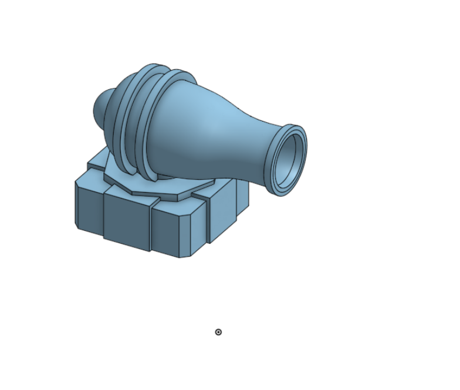
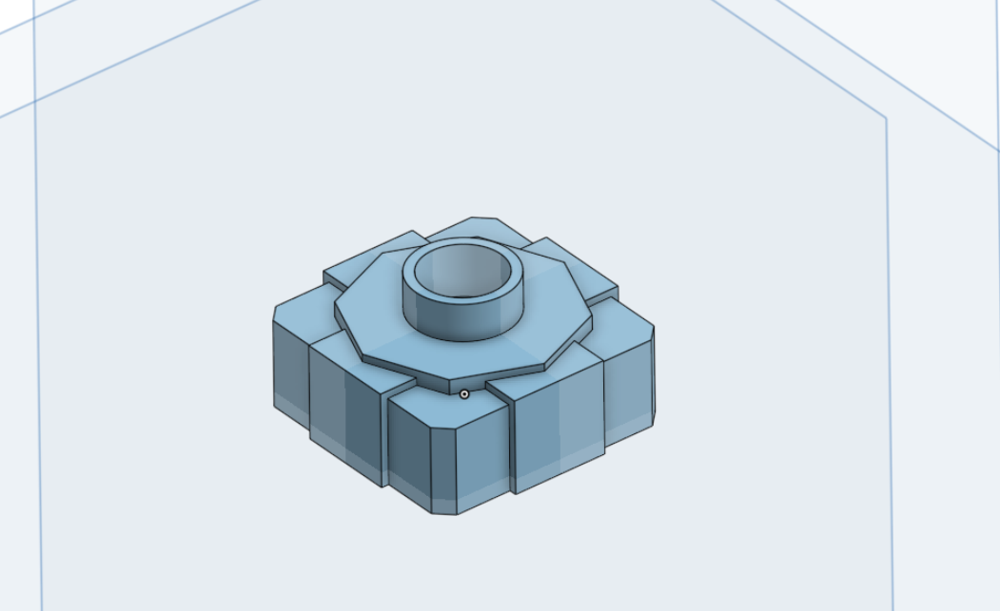
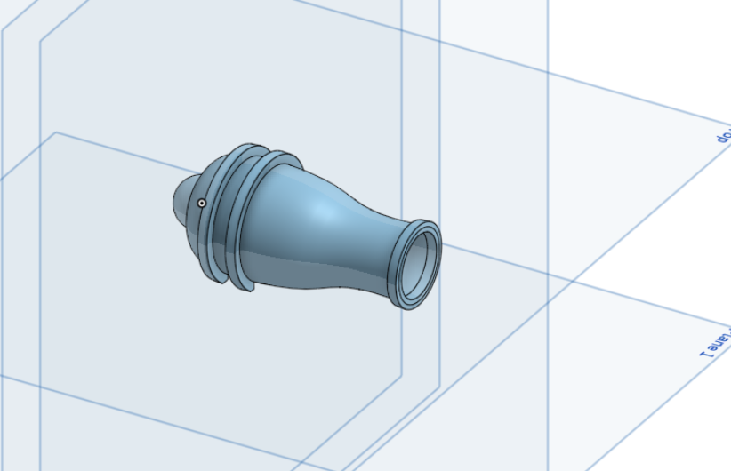
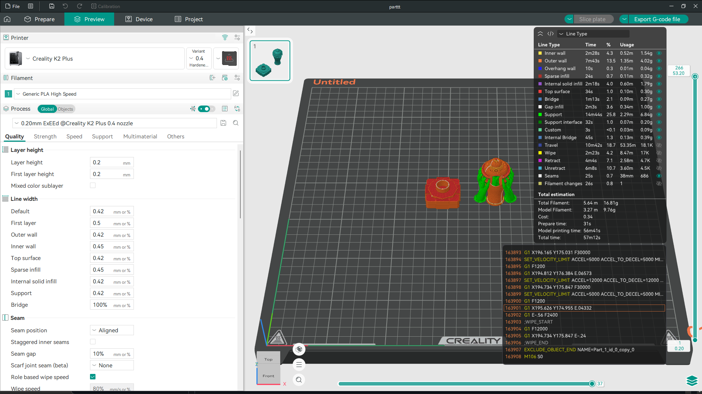

# Duplo Rotating Cannon (`duplo-rotating-cannon`)

A 2-piece 3D-printable cannon modeled in **Onshape** that snaps onto standard Duplo bricks and lets the barrel rotate freely on the base.

## Parts

* **Base:** Press-fits onto a standard Duplo brick and has a center cylindrical peg for the barrel to pivot on.
  

* **Barrel:** Sits on the base peg so it can spin smoothly 360°.
  

## Slicing & Print Settings

Both parts are arranged on one build plate in **Creality Print** for the **Creality K2 Plus** (`0.4 mm` nozzle), with the base printed flat and the barrel printed vertically using tree supports.

* **Material:** Generic PLA High Speed
* **Layer Height:** `0.20 mm`
* **Supports:** Tree supports on the barrel only
* **Total Filament:** `16.81 g`
* **Estimated Print Time:** `57m 12s`

## Files Included

* `cannon_assembly.3mf` — Multi-part 3D print file containing both the base and barrel
* `cannon_assembly.png`, `cannon_base.png`, `cannon_barrel.png` — Onshape CAD views
* `cannon_sliced.jpg` — Creality Print build plate and slicer preview
